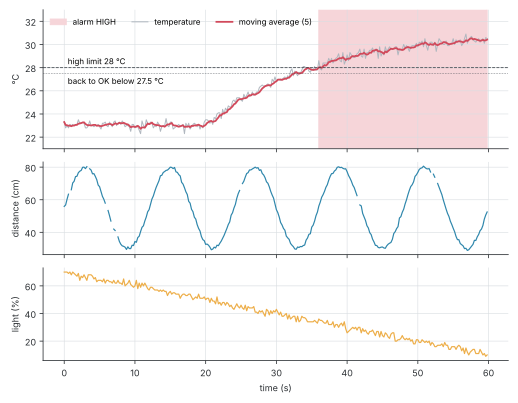

# LabVIEW DAQ Monitor

[](https://github.com/HannaBeshoy/labview-daq-monitor/actions/workflows/ci.yml)

**Introduction to Graphical Programming (LabVIEW) course project** · University of Debrecen, Faculty of Informatics · LabVIEW, Arduino, Python · **design, reference model and test vectors done; VIs built in LabVIEW next, hardware test on the December lab day**

A data-acquisition application: an Arduino measures temperature, distance and light and streams them over USB; a LabVIEW program reads the stream without ever blocking, filters it, raises a limit alarm that does not flicker, draws live charts and logs everything to a spreadsheet file. It uses every topic of the course: dataflow, data types and type definitions, arrays and shift registers, case structures, event-driven programming, subVIs, error clusters and file I/O.

- [x] Arduino sensor node: one CSV line per period, commands to change the period, stop and start
- [x] Architecture: event-driven UI loop, producer loop (serial), consumer loop (processing), joined by a queue
- [x] Reference model in Python, one function per subVI, with 14 unit tests in CI
- [x] Test vectors for every subVI and for the whole stream (300 readings, comment lines, missing echoes, a cut line)
- [x] Step-by-step build plan for every VI ([labview/BUILD.md](labview/BUILD.md))
- [ ] VIs built in LabVIEW and checked with SubVI Tester.vi against the test vectors
- [ ] Lab day: the app with the real Arduino ([test sheet](docs/LAB_DAY.md))

## What the app must show

The charts below are what the finished app has to draw for the test stream in `test_vectors/node_stream.txt`: a heater switched on at 20 s, an object moving to and fro in front of the sensor, light falling at dusk, and 3 % missing echoes (the gaps).



The 5-point moving average smooths the ±0.25 °C sensor noise; the alarm turns HIGH at 36.0 s when the average passes 28 °C and stays HIGH while the temperature hovers around the limit, because it only returns to OK below 27.5 °C (0.5 °C hysteresis).

## Architecture

```text
 Arduino ──USB──► producer loop ──queue──► consumer loop ──► charts, alarm, log file
 (CSV lines)      VISA Read, one line       Parse Line → Moving Average → Check Limits
                  or Simulated Source        → Statistics, Write to Text File
                         ▲
 UI loop (Event Structure): Start, Stop, period, limits ──► VISA Write commands to the Arduino
```

- **Producer–consumer.** Reading the serial port and processing the data run in separate loops joined by a queue, so a slow chart redraw never makes the program miss a line from the Arduino.
- **Event-driven UI.** The UI loop sleeps until a button or setting changes, instead of polling the front panel.
- **Type definitions.** `Reading.ctl` (a cluster) and `Alarm State.ctl` (an enum) are defined once; every wire and subVI uses them.
- **Subvis with state.** Moving Average and Check Limits keep their state in an uninitialised shift register or a feedback node between calls.
- **Robust parsing.** Command answers (`# ...`), empty lines, cut lines, text and out-of-range values are counted as bad lines and skipped, never passed on as zeros.

## Serial protocol

```text
Arduino → PC   <ms>,<temp_c>,<dist_cm>,<light_pct>     e.g. 12345,23.4,41.7,63   (empty distance = no echo)
               # ...                                    answers to commands, skipped by the parser
PC → Arduino   P<ms>  period 50..5000 ms    S  stop    G  go    ?  column names
```

## Reference model and test vectors

LabVIEW files are binary, so the processing rules are written once more in Python (`reference/daq.py`), one function per subVI with the same inputs and outputs, and tested (`tests/test_daq.py`). `reference/simulate_node.py` writes the test vectors:

| File | Checks |
| --- | --- |
| `parse_line.csv` | Parse Line.vi on 9 lines: good, no echo, comment, empty, cut, text, out of range |
| `moving_average.csv` | Moving Average.vi, including a NaN input |
| `check_limits.csv` | Check Limits.vi through every state change and the hysteresis band |
| `node_stream.txt`, `expected_log.tsv`, `expected_stats.txt` | the whole chain on 300 readings |

`SubVI Tester.vi` runs the subVIs on these tables in LabVIEW and must light every LED green.

## Running it

```bash
python3 -m unittest discover tests        # reference model tests
python3 reference/simulate_node.py        # regenerate the test vectors
python3 docs/figures.py                   # the expected charts
```

**Arduino:** wire the LM35 to A0, the HC-SR04 Trig to D9 and Echo to D10, the LDR divider to A1, upload `arduino/daq_node/daq_node.ino`, and check the lines in the Serial Monitor at 115200 baud.

**LabVIEW:** build the VIs following [labview/BUILD.md](labview/BUILD.md) (LabVIEW Community Edition with NI-VISA), then open `DAQ Monitor.vi`, choose the Arduino's COM port or the simulated source, and press Start.

## Repository layout

```text
arduino/daq_node/   the sensor node sketch
labview/            the build plan (and the VIs once built)
reference/          the processing rules in Python and the stream simulator
test_vectors/       inputs and expected outputs for every subVI
tests/              unit tests of the reference model
docs/               project guide, lab-day test sheet, figure script
```

See the [project guide](docs/PROJECT_GUIDE.md) for how each part maps to the course.

## Author

Beshoy Hanna · Computer Science Engineering BSc, University of Debrecen · [LinkedIn](https://www.linkedin.com/in/beshoy-hanna-8b52213a0)
